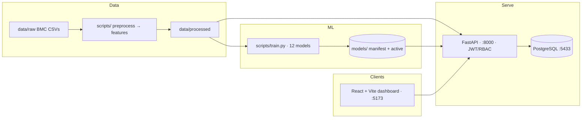

# WaterSphere AI

[](https://github.com/Ali-Dev-04/WaterSphereAI/actions/workflows/ci.yml)

**AI-powered smart water management for municipal wards.** WaterSphere forecasts ward-level water demand 1 / 3 / 7 days ahead (XGBoost, LSTM, GRU, Transformer — best-per-horizon selected), flags water stress early via the *Water Availability Ratio (WAR)*, plans zone-wise supply against live reservoir levels, maps stress on a GIS choropleth, and detects distribution losses — exposed through a FastAPI backend, an administration dashboard, and a PostgreSQL schema with full role-based access.

Built and validated end-to-end on real-style **BMC (Mumbai) ward data — 24 wards, daily 2023-01-01 → 2025-12-31** (26,304 consumption rows, 7,672 reservoir readings, 7 reservoirs).

---

## Why

Municipal demand varies by ward, but supply is usually scheduled manually — causing chronic under-supply in some areas and over-supply in others. Existing population/consumption/reservoir records are siloed. WaterSphere integrates them so planners can answer, per ward and per day: *how much demand is coming, how much water is actually available, and how should it be allocated?*

## Features

| Area | What it does |
|---|---|
| **Forecasting** | Ward daily demand at 1d / 3d / 7d horizons; four model families trained head-to-head with a naive baseline; the best family per horizon is selected on validation RMSE and labeled with its held-out test accuracy (`/api/model-info`) |
| **Water stress** | Ward WAR = (share of reservoir availability) × (supply factor vs demand); classified Safe / Moderate / High Stress / Shortage with env-tunable bands |
| **Supply planning** | Severity-weighted, forecast-capped allocator with redistribution and a 5% reserve — rule engine by default, optional exact LP solver (`planner_lp.py`, PuLP/CBC) via `SUPPLY_OPTIMIZER=lp` |
| **GIS map** | Ward polygons + reservoir markers, stress choropleth and 1-day forecast hover (Leaflet/OSM) |
| **Leakage indicators** | Loss = supplied − consumed per ward, IsolationForest anomaly flags, maintenance register |
| **Citizens** | Self-signup (ward-scoped read access), complaints filing + status tracking, and **guest reporting — "Report a water issue without sign-in"** (prominent login-page button; name, ward from live data, mandatory address & description, mandatory incident photo; `others` type for anything not listed; returns a reference number) |
| **Auth & roles** | JWT + RBAC; admins see all wards, citizens only their own. Login rate-limited |

## Live metrics (bmc-v1, held-out test set — touched once)

| active model | horizon | MAE | RMSE | MAPE | R² |
|---|---|---|---|---|---|
| XGBoost (HGB fallback) | 1d | 4.2154 | 5.7216 | 3.19% | 0.9906 |
| GRU | 3d | 4.2357 | 5.7393 | 3.26% | 0.9905 |
| GRU | 7d | 4.2900 | 5.7769 | 3.35% | 0.9904 |

All three beat the naive baseline (MAE 5.73–5.88). Full comparison table for all 12 models + baselines: [`Docs/EVALUATION.md`](Docs/EVALUATION.md).

## Architecture



- **Backend:** FastAPI, SQLAlchemy 2 + Alembic (11 tables), Pydantic v2, python-jose JWT, bcrypt, slowapi rate limits. Serves: `/auth`, `/forecast`, `/water-stress`, `/supply-plan`, `/gis`, `/leakage-risk`, `/maintenance`, `/complaints` (incl. the public guest report endpoint and admin-only photo fetch), `/model-info`, `/public/wards` — OpenAPI at `/docs`.
- **Frontend:** React 18 + Vite, Recharts, Leaflet, plain-CSS design tokens in a light municipal/utility theme, public landing entry screen, role-aware tabs, CSV export of the supply plan.
- **ML:** scikit-learn (HGB), TensorFlow/Keras (LSTM/GRU/Transformer), chronological splits *only* (no shuffle), features = population × demand lags/rolls × reservoir availability × calendar/seasonality.

## Quickstart

Prereqs: Docker. (Or Python 3.11 + Node 22.)

```bash
git clone https://github.com/Ali-Dev-04/WaterSphereAI.git
cd WaterSphereAI
cp .env.example .env          # dev defaults work as-is

docker compose up -d          # postgres + api (migrates & serves itself)
# first time: seed the DB
docker compose exec api python backend/seed.py

# dashboard
cd frontend && npm ci && npm run dev   # → http://localhost:5173
```

**Dev logins** (seeded, dev-only): `admin / admin123` — or create a citizen account from the login screen.

Ports: API `:8000` (docs `:8000/docs`) · Dashboard `:5173` · Postgres `:5433`.

### Without Docker

```bash
python -m venv .venv && source .venv/bin/activate
pip install -r backend/requirements.txt -r requirements.txt
# app package lives in backend/
PYTHONPATH=backend alembic upgrade head -c alembic.ini
PYTHONPATH=backend DATABASE_URL=... WS_BASE=$PWD python -m uvicorn app.main:app --port 8000
```

`WS_BASE` points the API at repo-root `models/` + `data/` (defaults to the container path `/code`).

## Repo layout

```
backend/        FastAPI app (routers, services, Alembic migrations, tests)
frontend/       React dashboard (Vite)
scripts/        data conversion → validation → features → training → evaluation → e2e
models/         trained artifacts registry (manifest + active selection; weights in releases)
data/           raw BMC CSVs + geojson, data dictionary & provenance
WaterSphere_BMC_Mumbai_D1_D7/   original D1–D7 source dataset
Docs/           PRD, architecture, evaluation report, workflows, design system
```

The full ML pipeline is reproducible: `validate_data.py → preprocess.py → features.py → train.py → evaluate.py` (writes `models/active.json` + test metrics). `e2e_check.py` runs the 31-case black-box verification; `pytest backend/tests` covers stress math and allocator units.

## Documentation

- [`Docs/PRD.md`](Docs/PRD.md) — product scope & requirements
- [`Docs/ARCHITECTURE.md`](Docs/Architecture.md) — system view
- [`Docs/EVALUATION.md`](Docs/EVALUATION.md) — model comparison & WAR calibration
- [`Docs/APP_WORKFLOW.md`](Docs/APP_WORKFLOW.md) — command reference (tracks B: platform)
- [`Docs/Context.md`](Docs/Context.md) — living project log
- [`Docs/demo.md`](Docs/demo.md) — demo walkthrough

## Security & configuration

Secrets come from environment only (`.env` / compose env — `JWT_SECRET`, DB URL, WAR bands, reserve %, optimizer choice; never commit them). The checked-in `.env.example` lists everything a fresh clone needs. This repo intentionally ships **dev-only** defaults (`admin/admin123`, `devpass`); production deployments must override them and provision admins explicitly.

## Status & roadmap

- ✅ dataset (bmc-v1) → features → 12-model training → evaluation → registry
- ✅ backend MVP + stress engine + supply planner (+ LP option) + GIS + leakage + complaints
- ✅ dashboard (role-aware, themed, exportable) · CI green · 31/31 e2e, 16/16 unit
- ⏳ staging deploy (Render + Netlify), Flutter citizen app

## Report

Issues → https://github.com/Ali-Dev-04/WaterSphereAI/issues
